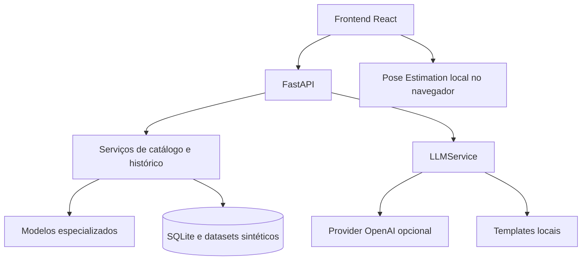

# Arquitetura do HealthAI Lab

O frontend carrega páginas grandes sob demanda. O navegador processa frames da webcam localmente com Pose Landmarker; somente métricas derivadas escolhidas pelo usuário são salvas no navegador. O evento de histórico central de uma sessão contém apenas contagem de amostras, movimentos e articulação, sem frames, imagens ou vídeo.

`GET /api/models`, `GET /api/datasets` e `GET /api/system/status` leem metadados e contagens. Não executam treinamento nem inferência. Os endpoints especializados continuam responsáveis pelas previsões. `POST /api/generative/explain` recebe apenas resumo estruturado do resultado e atua como camada de comunicação. A explicação e a previsão são eventos distintos em `AnalysisHistory`.

O banco SQLite é versionado pelo Alembic. A revisão inicial representa as tabelas das Partes 1–10; bancos legados são identificados e marcados na revisão inicial antes da atualização aditiva. `Base.metadata.create_all` deixou de ser a estratégia de migração. O volume Docker `/data` preserva banco, datasets e artefatos dos modelos.

## Fluxo por tipo de dado

- Planilha → modelos de classificação/regressão → resultado estruturado → explicação opcional.
- Série temporal → modelo de anomalias ou regressão → índice/estimativa → explicação opcional.
- Texto → TF-IDF e modelos de NLP → tema, grupo e similaridade → explicação opcional.
- Webcam → pose local → landmarks → cálculo geométrico → métricas numéricas locais.

Todos os dados de exemplo são sintéticos. Nenhum módulo produz diagnóstico ou recomendação clínica.
